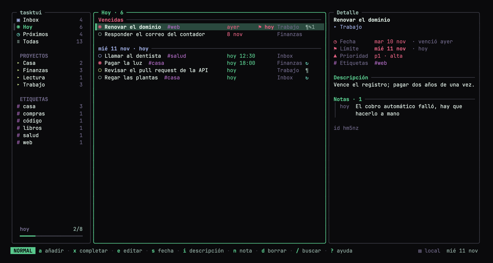
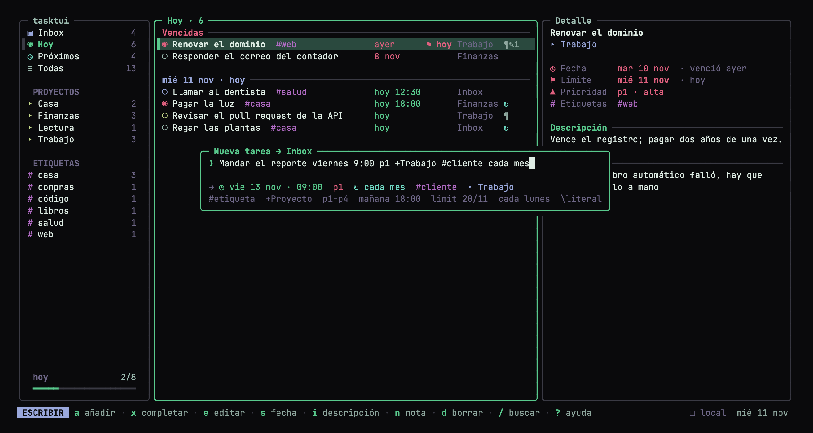
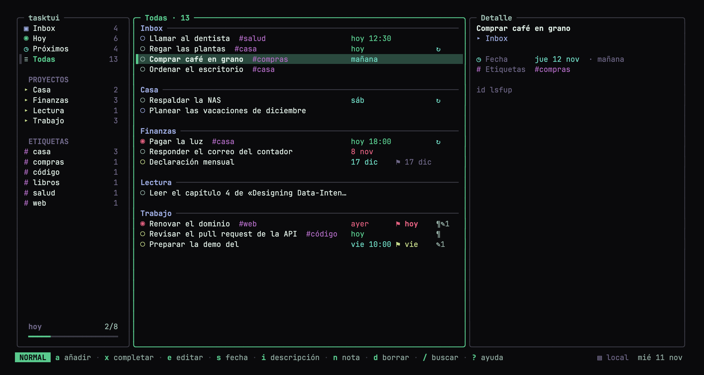

<div align="center">

# tasktui

**Tus tareas viven en tu terminal.**

Gestor de tareas hecho para el teclado, tuyo y en tu propio servidor:
TUI y CLI en Go, captura rápida en lenguaje natural, página web instalable
y servidor MCP para Claude.

[](https://github.com/alfonsoHR98/tasktui/actions/workflows/ci.yml)
[](go.mod)
[](LICENSE)

[**Página y demo en vivo**](https://alfonsohr98.github.io/tasktui/) · [Instalar](#instalación) · [Guía de uso](docs/uso.md) · [Servidor](docs/docker.md) · [MCP](docs/mcp.md)



</div>

## Por qué tasktui

- **Rápido de verdad.** Atajos estilo vim, deshacer de 50 pasos y todo a una tecla.
- **Escribe como hablas.** `Pagar luz mañana 18:00 p1 +Finanzas #casa cada mes`
  lleva fecha, hora, prioridad, proyecto, etiqueta y repetición en una línea.
- **Tuyo.** Sin cuenta ni nube ajena: Markdown en una carpeta o SQLite en tu
  servidor. Exportas todo cuando quieras.
- **En todas tus pantallas.** Un servidor propio comparte las mismas tareas con
  la terminal, el navegador (PWA) y Claude por MCP.
- **Bonito por defecto.** Tema Aurora en color verdadero, o los colores de tu
  terminal con `theme = "ansi"`.

## Pruébalo en un minuto

Requiere [Go](https://go.dev/dl/) 1.27 o superior.

```sh
go install github.com/alfonsoHR98/tasktui/cmd/tasktui@latest
tasktui demo      # la TUI con tareas de ejemplo; no toca nada tuyo
```

¿Sin instalar nada? La [página del proyecto](https://alfonsohr98.github.io/tasktui/)
tiene una réplica interactiva.

## Captura rápida



| Escribe | Significa |
|---|---|
| `#casa` | etiqueta |
| `+Trabajo` · `+Mis_Cuentas` | proyecto (si no existe, se crea) |
| `p1` … `p4` | prioridad |
| `hoy`, `mañana`, `viernes`, `en 3 días`, `15/11` | fecha |
| `18:00`, `9am` | hora |
| `limit 20/11` | fecha límite |
| `cada mes`, `cada lunes`, `cada 2 semanas` | repetición |

La misma sintaxis sirve en la TUI, la CLI, la web, la API y el MCP.
Tabla completa en [docs/uso.md](docs/uso.md).

## Instalación

Hay dos formas de usarlo. Puedes empezar con la primera y pasar a la segunda
cuando quieras, sin perder tareas (`tasktui server push`).

### 1 · Solo terminal (sin servidor)

```sh
go install github.com/alfonsoHR98/tasktui/cmd/tasktui@latest
tasktui                                            # abre la TUI
tasktui add Pagar luz mañana 18:00 p1 +Finanzas    # o desde la CLI
```

Las tareas se guardan como Markdown compatible con
[Obsidian Tasks](https://publish.obsidian.md/tasks/) en `~/.local/share/tasktui`.
Para verlas en Obsidian, apunta la carpeta a tu vault:
`tasktui dir ~/ruta/a/tu/vault/Tareas`. Más en [docs/modos.md](docs/modos.md).

### 2 · Con tu propio servidor (Docker)

El servidor es un solo contenedor con la API, la página web y el MCP; las
tareas viven en un archivo SQLite dentro de un volumen.

```sh
git clone https://github.com/alfonsoHR98/tasktui.git && cd tasktui
cp .env.example .env        # pon un API_TOKEN:  openssl rand -hex 24
docker compose up -d --build
```

Abre `http://127.0.0.1:8787`, entra con tu token y conecta la terminal:

```sh
tasktui server connect http://127.0.0.1:8787    # pide el token
```

Para usarlo fuera de casa necesitas HTTPS: [docs/docker.md](docs/docker.md)
explica Caddy, Cloudflare Tunnel y Tailscale, además de respaldos y
actualizaciones.

<details>
<summary>Sin Docker: el servidor como binario</summary>

```sh
make server
API_TOKEN=$(openssl rand -hex 24) DATABASE_PATH=./tasktui.db ./tasktui-server
```

Go puro, sin cgo: corre igual en un VPS, una Raspberry Pi o tu Mac.
</details>

<details>
<summary>Desde el código</summary>

```sh
git clone https://github.com/alfonsoHR98/tasktui.git && cd tasktui
make install      # instala tasktui en ~/go/bin
make test
```
</details>

## Cómo funciona

```
 TUI / CLI ─┐
 Web (PWA) ─┼──  HTTPS + token  ──►  tasktui-server  ──►  SQLite
 Claude    ─┘  (MCP)                 API · web · MCP
```

Un servidor es la fuente de verdad y todos los clientes hablan la misma API.
La lógica (captura rápida, vistas, repeticiones) vive en un núcleo compartido,
`internal/core`, así que una tarea se interpreta igual en todas partes. Sin
servidor, ese mismo núcleo lee y escribe tus archivos `.md`.

## Qué incluye

| | | Guía |
|---|---|---|
| **TUI** | tres paneles, detalle con descripción y notas, avance del día | [uso](docs/uso.md) |
| **CLI** | cada comando acepta `--json`, para scripts y agentes | [uso](docs/uso.md#cli-scripts-y-claude) |
| **Servidor** | API JSON con SQLite, en Docker o como binario | [docker](docs/docker.md) · [API](docs/api.md) |
| **Página web** | PWA instalable servida por el mismo binario; lee sin conexión | [web](docs/web.md) |
| **MCP** | Claude y otras IAs manejan tus tareas con las mismas reglas | [MCP](docs/mcp.md) |
| **Avisos en la Mac** | alerta nativa a la hora de la tarea, con Completar y Posponer | [abajo](#avisos-en-la-mac) |
| **Respaldo** | `tasktui export` a Markdown y `/api/export` en JSON | [docker](docs/docker.md#datos-y-respaldos) |

La app nativa de iPhone (`ios/`) está en desarrollo y todavía no forma parte de
una versión publicada; mientras tanto, la página web se instala en el celular.

### Atajos principales

| Tecla | Acción | Tecla | Acción |
|---|---|---|---|
| `j` `k` | moverse | `a` | añadir |
| `h` `l` | barra lateral ↔ lista | `x` | completar / reabrir |
| `gi` `gt` `gu` `ga` | Inbox · Hoy · Próximos · Todas | `e` | editar |
| `/` | buscar | `s` | fecha, hora y límite |
| `u` | deshacer | `?` | todos los atajos |



### Avisos en la Mac

```sh
tasktui notify install     # arranca al iniciar sesión (launchd)
tasktui notify test        # muestra una alerta de prueba
tasktui notify uninstall
```

Al llegar la hora de una tarea (9:00 si solo tiene fecha) aparece una alerta que
se queda en pantalla hasta que la cierras, con **Completar**, **Posponer 10 min**
y **Cerrar**. Con [terminal-notifier](https://github.com/julienXX/terminal-notifier)
instalado (`brew install terminal-notifier`) la alerta es nativa; sin él se usa
un diálogo del sistema.

## Personalización

```toml
# ~/.config/tasktui/config.toml
theme = "aurora"   # o "ansi": usa los 16 colores de tu terminal
```

También `TASKTUI_THEME=ansi tasktui`. Todas las opciones y variables están en
[docs/modos.md](docs/modos.md#archivos-de-configuración).

## Documentación

| | |
|---|---|
| [docs/uso.md](docs/uso.md) | captura rápida, atajos de la TUI, tema y CLI |
| [docs/modos.md](docs/modos.md) | modo local y remoto, configuración, formato Markdown |
| [docs/docker.md](docs/docker.md) | servidor autoalojado, HTTPS, respaldos, variables |
| [docs/mcp.md](docs/mcp.md) | conectar Claude u otra IA |
| [docs/api.md](docs/api.md) | rutas de la API |
| [docs/web.md](docs/web.md) | la página web / PWA |
| [docs/ios.md](docs/ios.md) | la app de iPhone (en desarrollo) |
| [docs/desarrollo.md](docs/desarrollo.md) | estructura del código, pruebas y versiones |

## Seguridad

- El token es la única llave: genera uno largo y no lo subas a ningún repo
  (`.env` está en `.gitignore`).
- Usa siempre HTTPS fuera de tu red. El secreto del MCP va en la URL; trátalo
  como una contraseña.
- Es una herramienta **personal** (un usuario, un token), no un servicio
  multiusuario.

Para reportar una vulnerabilidad, lee [SECURITY.md](SECURITY.md).

## Hoja de ruta

- **Siguiente:** binarios e imagen de Docker publicados con cada versión,
  instalación con `brew`, avisos push en la página web.
- **Después:** filtros guardados (`(hoy | vencidas) & #work`), subtareas y
  reordenar desde la TUI, más temas de color, app de iPhone.
- **Ideas abiertas:** otras bases además de SQLite, abrir la tarea en Obsidian.

Lo ya publicado está en [CHANGELOG.md](CHANGELOG.md).

## Contribuir

Las ideas, los reportes y los pull requests son bienvenidos. Empieza por
[CONTRIBUTING.md](CONTRIBUTING.md); la estructura del código está en
[docs/desarrollo.md](docs/desarrollo.md).

## Licencia

[MIT](LICENSE) © alfonsoHR98
