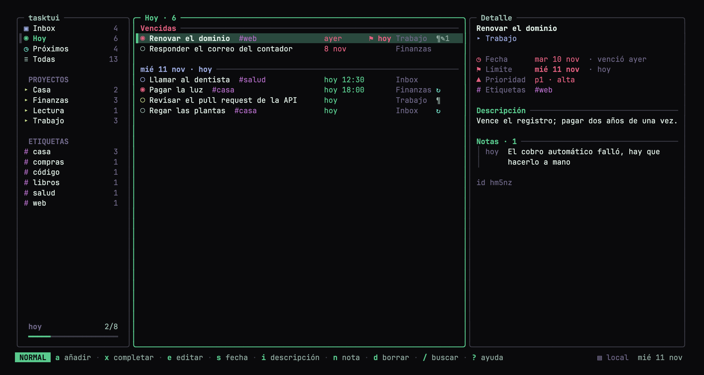
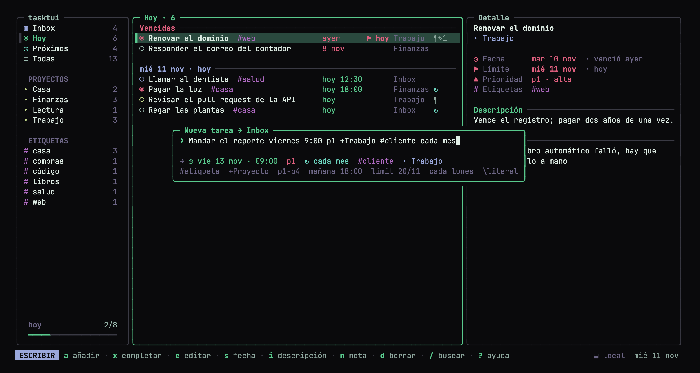

# Uso: tareas, captura rápida, atajos y CLI

## Una tarea

| Campo | Para qué |
|---|---|
| Fecha (+ hora opcional) | cuándo piensas hacerla (con hora opcional) |
| Fecha límite | cuándo **debe** estar hecha; aparece en «Hoy» cuando llega y en rojo si pasó |
| Descripción | texto libre de varias líneas (contexto, enlaces) |
| Notas | comentarios de seguimiento, cada uno con su fecha |
| Prioridad, etiquetas, proyecto, sección, repetición | como en Todoist |

## Captura rápida

```
Entregar reporte viernes 18:00 p1 #trabajo +Cliente limit 20/11
Pagar luz mañana p1 #casa +Finanzas cada mes
```

| Escribe | Significa |
|---|---|
| `#casa` o `@casa` | etiqueta |
| `+Trabajo` · `+Mis_Cuentas` | proyecto (`_` = espacio; si no existe, se crea) |
| `p1` … `p4` | prioridad |
| `hoy`, `mañana`, `pasado mañana` · `today`, `tomorrow` | fecha |
| `lunes` … `domingo` · `monday` … `sunday` | el próximo ese día |
| `en 3 días`, `en 2 semanas` · `in 3 days`, `in 2 weeks` | fecha relativa |
| `15/11`, `15/11/2026`, `2026-11-15` | fecha exacta |
| `18:00`, `9:30`, `9am`, `6:30pm` | hora (sin fecha, es para hoy) |
| `limit 20/11`, `limit viernes`, `{20/11}`, `{en 3 días}` | fecha límite |
| `cada día`, `cada 2 semanas`, `cada lunes` · `every day`, `every 2 weeks`, `every monday` | repetición |
| `\hoy` | la palabra como texto literal |

## Atajos (TUI)



Tres paneles: vistas, proyectos y etiquetas a la izquierda; la lista al centro;
el detalle a la derecha (abajo, si la terminal es angosta). El panel con foco
lleva el marco verde. Al pie de la barra lateral, `hoy 2/8` es tu avance del
día: hechas hoy frente a todo lo que tocaba hoy.

En la lista, cada columna va alineada: texto (con etiquetas), fecha y hora,
`⚑` fecha límite, proyecto e íconos (`¶` tiene descripción, `✎2` tiene 2
notas, `↻` se repite). El círculo toma el color de la prioridad y `◉` marca p1.

La barra de abajo dice en qué modo estás (`NORMAL`, `ESCRIBIR`, `BUSCAR`,
`ELIMINAR`), los atajos principales y, a la derecha, dónde viven tus tareas
(`▤ local`, `☁ remoto` o `⚠ sin conexión`).

¿Solo quieres verla? `tasktui demo` la abre con tareas de ejemplo en una carpeta
temporal, sin tocar las tuyas.

| Tecla | Acción |
|---|---|
| `j` `k` / flechas | moverse |
| `h` `l` / `Tab` | barra lateral ↔ lista |
| `gi` `gt` `gu` `ga` | Inbox · Hoy · Próximos · Todas |
| `gg` `G` | inicio / final |
| `a` | añadir (en Hoy pone fecha de hoy; en un proyecto o etiqueta, la usa) |
| `Tab` · `↑` `↓` | al escribir `+pro` o `#eti`: completar el proyecto o la etiqueta (busca en cualquier parte del nombre) |
| `e` | editar con la misma sintaxis |
| `x` / espacio | completar / reabrir |
| `s` | fecha, hora y límite (`mañana 18:00 limit 20/11`) · `t` para hoy |
| `i` | editar la descripción en `$EDITOR` |
| `n` | añadir una nota (con la fecha de hoy) |
| `1`–`4` | prioridad |
| `d` | eliminar la tarea (pide confirmación); con el foco en el panel y un proyecto seleccionado, elimina el proyecto y sus tareas (`u` lo deshace) |
| `u` | deshacer (hasta 50 pasos) |
| `/` · `Esc` | buscar · limpiar |
| `H` | mostrar completadas |
| `r` | recargar (también se recarga solo cada 30 s sin actividad) |
| `?` · `q` | ayuda · salir |

## Tema de color

Por defecto la TUI usa **Aurora** en color verdadero (verde de acento sobre
negro). Si prefieres que siga los 16 colores de tu terminal, y con ellos el tema
que ya tengas puesto, usa `ansi`:

```sh
TASKTUI_THEME=ansi tasktui                       # solo esta vez
echo 'theme = "ansi"' >> ~/.config/tasktui/config.toml   # siempre
```

`NO_COLOR=1` quita todos los colores.



## CLI (scripts y Claude)

```sh
tasktui add Pagar luz mañana 18:00 p1 '#casa' limit 20/11 -d "Recibo de CFE"
tasktui list                               # hoy + vencidas (y límites que llegaron)
tasktui list upcoming | inbox | all | +Trabajo | '#casa'
tasktui list +Trabajo --all --search PR    # incluir completadas, filtrar texto
tasktui show frlyy                         # la tarea con su descripción y notas
tasktui done frlyy                         # completar / reabrir
tasktui edit frlyy viernes 9am p2          # cambia solo lo indicado
tasktui edit frlyy '{25/11}'               # cambia la fecha límite
tasktui edit frlyy --no-date | --no-deadline
tasktui describe frlyy Texto nuevo         # sin texto abre $EDITOR
tasktui note frlyy Llamaron, sigue pendiente
tasktui rm frlyy
tasktui projects | labels
tasktui projects rm <proyecto> [--yes]   # elimina el proyecto y sus tareas
tasktui list --json                        # cualquier comando acepta --json
tasktui demo                               # la TUI con tareas de ejemplo
```

Los comandos están en inglés; los nombres anteriores en español (`servidor`,
`exportar`, `--sin-fecha`, `--buscar`…) siguen funcionando como alias.

